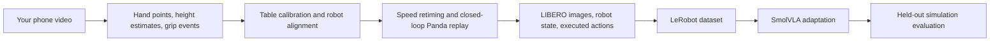

# Phone to Panda

Humanoid Robot Learning Research internship challenge. Personal phone recordings are turned
into Panda end-effector trajectories, replayed in LIBERO, and used to build simulation
demonstrations for SmolVLA adaptation.

**Status: implementation and synthetic smoke tests. Personal-data collection, task-performance
experiments, and SmolVLA training are pending. This repository is not yet a completed challenge
submission.** No results from applicant recordings are claimed.

Repository for the Ashby application: **https://github.com/DFly7/humanoid-intern-challenge**.
Submission deadline provided in the challenge: **9 October 2026, 23:59 BST**.

## Approach



The recording supplies the motion and contact timing. A planar calibration supplies metres.
The simulator supplies robot observations and executed actions. That distinction is important:
phone video alone does not tell us Panda joint commands or monocular depth.

The initial teacher keeps wrist orientation fixed and uses manual height estimates. It slows
segments to a velocity limit while preserving pauses and discrete gripper transitions.
Source hashes, calibration, and retiming settings follow each trajectory into its metrics.
The training exporter accepts only successful, personally collected, train-split teacher runs.

## Quick start: laptop software check

Install [uv](https://docs.astral.sh/uv/getting-started/installation/), then:

```bash
git clone https://github.com/DFly7/humanoid-intern-challenge.git
cd humanoid-intern-challenge
uv sync --python 3.12 --extra dev
uv run pytest -q
uv run humanoid prepare examples/synthetic/manifest.json \
  --output data/processed/synthetic.npz
```

The synthetic example produces a 51-frame trajectory and a JSON sidecar. It is a generated
software fixture, not a recorded demonstration. Commands refuse to overwrite trajectories
or rollout directories; use a new output name for each experiment.

## Install and run LIBERO/Panda

Python 3.12 is the reference interpreter. LIBERO and robosuite need OpenGL; use EGL on a Linux
GPU machine and the default CGL backend on macOS. Older upstream requirements pin MuJoCo 2.3.7,
which lacks a Python 3.12 wheel; this project uses MuJoCo 3.2.7 with robosuite 1.4.1.
The setup below uses a specific LIBERO source commit and a project-local config.
The compatibility editable mode is required because upstream uses a namespace package.

```bash
uv sync --python 3.12 --extra dev --extra sim
mkdir -p third_party
git clone https://github.com/Lifelong-Robot-Learning/LIBERO.git third_party/LIBERO
git -C third_party/LIBERO checkout 8f1084e3132a39270c3a13ebe37270a43ece2a01
uv pip install --python .venv/bin/python --no-deps \
  --config-settings editable_mode=compat -e third_party/LIBERO
uv run --no-sync python scripts/setup_libero.py third_party/LIBERO
export LIBERO_CONFIG_PATH="$PWD/.libero"
# Linux GPU/headless only:
# export MUJOCO_GL=egl
uv run --no-sync humanoid tasks --suite libero_goal
uv run --no-sync humanoid rollout data/processed/synthetic.npz \
  --suite libero_goal --task-id 0 --init-id 0 \
  --output outputs/synthetic-smoke
```

`--no-sync` retains the separately installed LIBERO package. If you sync again, reinstall that
editable package. `setup_libero.py` creates the config once; reuse it for later runs. No upstream
robot demonstrations are downloaded or used for the phone-data path.

Each run writes `rollout.mp4`, `metrics.json`, `episode.npz`, and two directories of pre-action
camera frames. `initial_scene.png` and `initial_state.json` help inspect the scene and its world
coordinates when configuring alignment. Task success comes from LIBERO's predicate; path tracking error is separate.
Synthetic smoke-test success is not a challenge result. See [results](results/README.md).

## Use your own phone data

Follow [the recording and annotation guide](docs/recording.md). Open
`tools/annotate.html` directly in your browser to annotate a local video; it uploads nothing.
Record a fixed camera view for this initial implementation, measure four table reference
points, and align them to the chosen simulated scene.

```bash
uv run --no-sync humanoid prepare data/raw/session_01/manifest.json \
  --output data/processed/attempt_001.npz
uv run --no-sync humanoid rollout data/processed/attempt_001.npz \
  --suite libero_goal --task-id YOUR_TASK_ID --init-id 0 \
  --output outputs/attempt_001
```

Replace `YOUR_TASK_ID` with a number from `humanoid tasks`. The manifest's instruction should
match that task. Inspect the original clip, calibrated path, and simulation output together.
Raw phone videos, simulator dumps, and model weights are ignored by Git by default. Publish a
small reviewed example under `results/` and provide a dataset download link when results exist.

## Build a dataset and adapt SmolVLA

This is the GPU stage; a CUDA Linux machine or Colab GPU is suitable. LeRobot is pinned to source
commit `0b067df57d21d3a02d6c511f1609172fa39ac29b` (version 0.4.3). Its native dependencies may
require system FFmpeg development/runtime packages. Start with a batch size of 8 and adjust
after measuring memory. There are no trained checkpoints in this repository.

```bash
uv sync --python 3.12 --extra dev --extra sim --extra ml
uv pip install --python .venv/bin/python --no-deps \
  --config-settings editable_mode=compat -e third_party/LIBERO
export LIBERO_CONFIG_PATH="$PWD/.libero"
uv run --no-sync humanoid export outputs/attempt_001 outputs/attempt_002 \
  --repo-id DFly7/phone-panda --output data/lerobot/phone-panda
source .venv/bin/activate
bash scripts/train_smolvla.sh DFly7/phone-panda \
  data/lerobot/phone-panda outputs/smolvla
```

The dataset remains local; the repo ID is a LeRobot identifier and export does not upload it.
Export saves RGB images rather than encoded videos to keep the small-dataset path inspectable.
Training clears the base checkpoint's input-feature specification so LeRobot infers our two
cameras and 9D state from the dataset instead of retaining the base SO100 setup.
Its state is 9D (`xyz`, quaternion `xyzw`, two finger positions); action is 7D normalized
`OSC_POSE` translation/rotation/gripper, with `-1` open and `+1` close. Pre-action observations
are aligned with actions. The exporter and inference bridge both use raw simulator camera
orientation. The displayed replay video flips vertically for viewing.

After training, find a checkpoint containing `pretrained_model/` and evaluate it:

```bash
humanoid rollout data/processed/held_out_attempt.npz \
  --policy outputs/smolvla/checkpoints/005000/pretrained_model \
  --device cuda --suite libero_goal --task-id YOUR_TASK_ID --init-id 15 \
  --output outputs/vla-held-out-15
```

The trajectory determines evaluation duration and a reference path; the VLA selects actions
from current simulated images, robot state, and the task instruction. It receives no phone
trajectory targets. The bridge loads checkpoint normalization and tokenizer processors.
Always evaluate disjoint initial states and source sessions. Five thousand steps is an initial
budget, not a claim that this amount is sufficient.

## Results and design notes

See [results/README.md](results/README.md) for measured software evidence and the current gaps.
[The experiment protocol](docs/experiments.md) specifies proposed comparisons, held-out splits,
success reporting, and failure analysis. The simple baseline is intentional: calibration,
contact height, wrist orientation, and simulator task success should be understood before
adding model complexity. A trained SmolVLA is the planned student, not a claimed current result.

## Development

```bash
uv run --no-sync ruff check .
uv run --no-sync pytest -q
```

GitHub Actions checks the core geometry, provenance gates, CLI conversion, and linting.
Simulation and GPU training are separate checks requiring their optional dependencies.

Upstream references: [LIBERO](https://github.com/Lifelong-Robot-Learning/LIBERO),
[LeRobot 0.4.3](https://github.com/huggingface/lerobot/tree/0b067df57d21d3a02d6c511f1609172fa39ac29b),
[SmolVLA guide](https://huggingface.co/docs/lerobot/smolvla),
[base checkpoint](https://huggingface.co/lerobot/smolvla_base).
