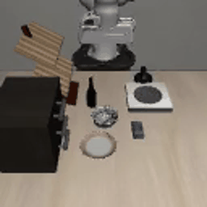

# Results so far

## Synthetic simulation smoke test

This video shows an actual offscreen-rendered LIBERO/Panda run of the generated loop in
`examples/synthetic/`. The selected drawer task is a scene for this software check; the loop
is not a drawer-opening demonstration. **It contains no personally collected data.**

| Measurement | Observed value |
| --- | --- |
| Suite / task / initial state | `libero_goal` / `0` / `0` |
| Control frequency / executed steps | 20 Hz / 51 |
| Task success | false |
| Mean target tracking error | 0.0588 m |
| Maximum target tracking error | 0.2425 m |
| Meanings of the errors | Post-step end-effector distance from that step's target |

The maximum error includes the arm's approach from its initial pose to the first synthetic
target. The path is speed-retimed; the initial mismatch is not eliminated by that operation.
These values describe one software check and are not a policy benchmark.

Evidence: [raw metrics](synthetic-smoke/metrics.json),
[runtime versions](synthetic-smoke/environment.json),
[initial scene](synthetic-smoke/initial_scene.png),
[initial world coordinates](synthetic-smoke/initial_state.json),
[MP4 replay](synthetic-smoke/rollout.mp4).

## Verification

- Core geometry/provenance tests and Ruff lint checks pass.
- The CLI converts the synthetic annotations into 51 finite targets with source hashes.
- Task discovery and rendered simulation run on Apple Silicon / Python 3.12.
- LeRobot dataset and SmolVLA imports pass in the optional ML environment.
- A temporary three-frame synthetic LeRobot dataset exercises image/state/action writes and
  finalization. It is an API smoke test, not applicant data or training evidence.
- The browser annotation page loads and its controls/scripts initialize. Full video annotation
  has not been tested with an applicant recording.

## What is still missing

| Challenge evidence | Status |
| --- | --- |
| Applicant's original manipulation recordings | Awaiting collection |
| Calibrated personal-data trajectories | Awaiting recordings and measured calibration |
| Successful phone-derived manipulation episodes | Not measured |
| SmolVLA adaptation and checkpoint | Not trained |
| Held-out task success / failure analysis | Not measured |
| Paired phone/simulator demonstration | Not produced |

## Design choices and observed problems

Manual annotations keep the early data path inspectable. Four table correspondences give a
clear geometric mapping, but they do not recover height and do not support a moving camera.
The fixed-wrist controller is another explicit limitation. These are reasons to choose a small
tabletop interaction first, not evidence that arbitrary human manipulation transfers.

Setup checks found three upstream integration issues: MuJoCo 2.3.7 has no Python 3.12 wheel;
modern editable installs need compatibility mode for LIBERO's namespace package; and Torch
2.6+ changes the default loading mode for LIBERO initial-state pickles. The documented setup
uses MuJoCo 3.2.7, compatibility editable mode, and explicit loading of the pinned upstream
initial-state assets. LeRobot 0.4.3 needs NumPy 2 through its visualization dependency, so the
project's resolved environment uses NumPy 2.2.6. The exercised LIBERO path works in that
environment; upstream Gym prints its compatibility warning and unexercised Gym wrappers
are not verified.

The pretrained SmolVLA config describes a different camera/state layout. The training script
clears its input features so LeRobot derives this dataset's two cameras and 9D state.
No GPU training run has verified the full adaptation/inference path yet.
